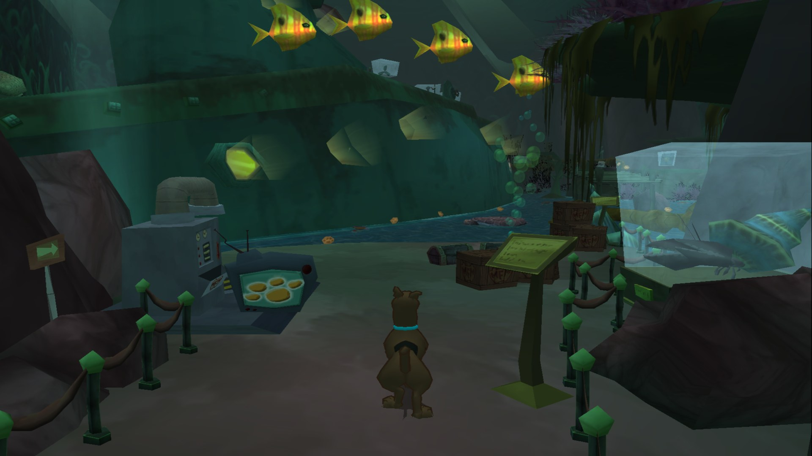
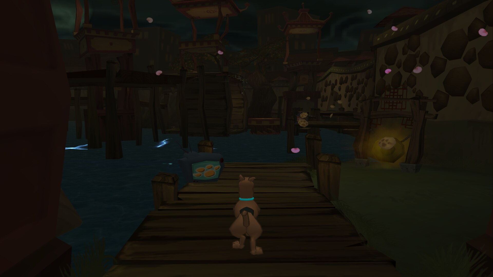
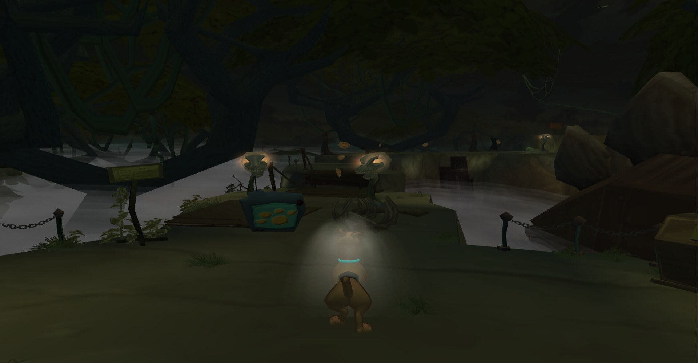
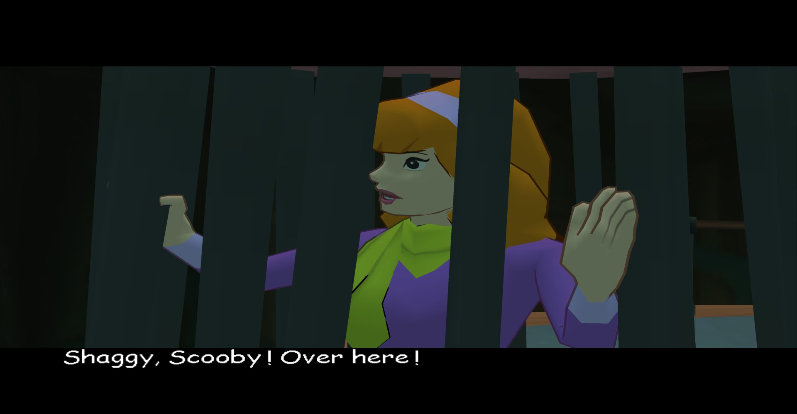
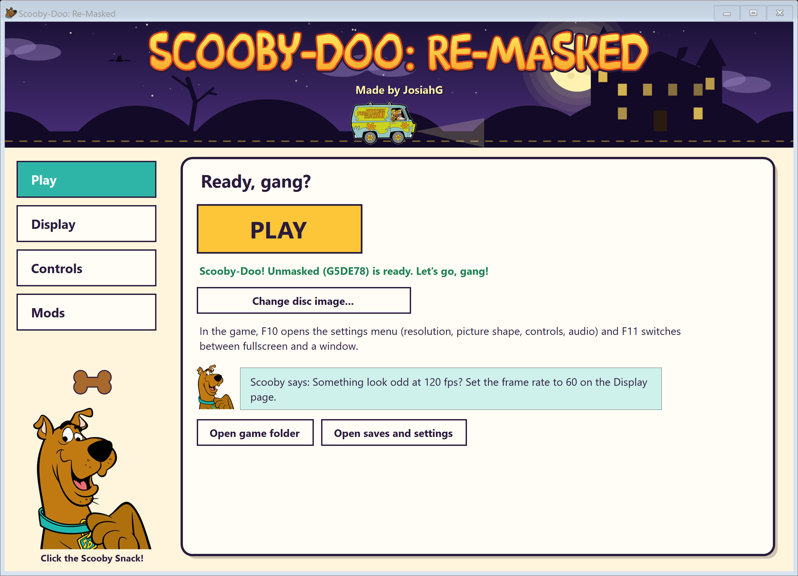

# Scooby-Doo: Re-Masked

A native PC port of **Scooby-Doo! Unmasked** (GameCube, 2005), made by statically recompiling the game's PowerPC
code to C++ with [WiiCompiled](https://github.com/patchzyy/Wiicompiled). No emulator: the game runs as a Windows
program, drawn by a modern renderer.



<p>
  
  
  
</p>

*Screenshots from this port, rendered in widescreen.*

## Features

- **Up to 4K** (720p, 1080p, 4K or your screen's size)
- **Widescreen**: original 4:3, 16:9, fill the screen, or cinematic 2.39:1
- **120 or 180 fps** with frame interpolation (the game itself runs at its original 60)
- **HDR** output (scRGB) on HDR displays, with brightness and highlight controls
- Tear-free presentation, borderless or exclusive fullscreen, or a window
- **Gamepads** (Xbox, PlayStation, Switch Pro, GameCube adapter) and keyboard, remappable in game; button prompts
  match your controller
- GameCube memory-card saves, and mods that replace game files or textures
- A launcher that installs the game from your own disc image

**No game data is included**: the game's data and its original code are read from your own disc at startup.

## Playing

You need **Windows 10 or 11 (64-bit)** and your own dump of **Scooby-Doo! Unmasked for the GameCube, USA
(G5DE78)** as a `.iso`, `.gcm` or `.ciso` file (for example dumped with CleanRip on a Wii).



1. Download the latest release and unzip it anywhere.
2. Open **`Scooby-Doo Re-Masked.exe`**, the only program you need to open.
3. On the **Play** page choose your disc image. The game files are copied into the `data` folder once; the image
   file isn't needed afterwards.
4. Pick display options on the **Display** page and press **PLAY**.

In game, **F10** opens the settings menu (resolution, picture shape, frame rate, controls, audio) and **F11**
switches between fullscreen and a window.

| Keyboard | GameCube |
|---|---|
| W A S D | Control stick |
| Arrow keys | C-stick (camera) |
| Space | A |
| Left Shift | B |
| R / F | X / Y |
| C | Z |
| Q / E | L / R |
| Enter | Start |
| I J K L | D-pad |

Saves and settings live in `data\UserData`. Mods go in `data\UserData\mods\<name>\` with a `files\` folder that
mirrors the disc (replacing game files) and/or a `textures\` folder of texture replacements; the launcher's
**Mods** page switches them on and off. To update, unzip a new release over the old folder: your disc, saves and
settings are kept.

## Building from source

Windows 10/11 x64 with **Python 3** and **Git** on PATH. Everything else (LLVM-MinGW, CMake, Ninja, SDL3, Dawn, the
.NET 8 SDK) is downloaded into the repository's `toolchain\` and `wiicompiled\Dependencies\` folders on the first
build; nothing is installed system-wide.

```powershell
git clone https://github.com/josiahg2502-glitch/Scooby-Doo-ReMasked
cd Scooby-Doo-ReMasked
powershell -ExecutionPolicy Bypass -File tools\build-launcher.ps1
# Extract your disc image to Disc\DATA (the translation reads the game's code from it):
& "launcher\publish\Scooby-Doo Re-Masked Launcher.exe" --extract "C:\path\to\Scooby-Doo Unmasked.iso" Disc\DATA
powershell -ExecutionPolicy Bypass -File tools\build-scooby.ps1
powershell -ExecutionPolicy Bypass -File tools\package-scooby.ps1 -Zip
```

`build-scooby.ps1` translates the game (about 28,000 functions) and compiles it; the first build takes a while.
The game lands in `Play\`, and `package-scooby.ps1` assembles `dist\ScoobyDooReMasked\` (and `-Zip` the release
zip). Build logs are in `build-logs\`. `AGENTS.md` has the technical notes: how the logic modules, the display
copy, the GameCube DVD/card/audio paths and the renderer fixes work.

### Layout

| Path | What |
|---|---|
| `wiicompiled/translator` | PowerPC to C++ static recompiler (C#) |
| `wiicompiled/runtime` | Runtime and GameCube SDK HLE (OS, DVD, card, PAD, AX audio, VI, GX) |
| `wiicompiled/aurora-main` | Aurora: GameCube GX on WebGPU (Dawn / Direct3D 12) |
| `wiicompiled/projects/scooby` | This game's project: symbols, function map, address remaps, logic-module tools |
| `launcher` | The launcher (C# WinForms): disc setup, display options, controls, mods |
| `tools` | Build, package and test scripts |

## Credits

- **Port:** JosiahG
- **[WiiCompiled](https://github.com/patchzyy/Wiicompiled)** (the recompiler and runtime) by patchzyy and
  contributors, GPLv3
- **Aurora** by Luke Street, MIT; Dawn, SDL3 and the other components listed in
  [`wiicompiled/THIRD-PARTY-NOTICES.md`](wiicompiled/THIRD-PARTY-NOTICES.md)
- Launcher title font **"Scooby Doo"** by Lauren Ashpole
  ([FontSpace](https://www.fontspace.com/scooby-doo-font-f7039)), free for personal use
- Launcher Scooby and Mystery Machine images: fan art (the Scooby picture also replaces the HUD portrait)
- Button prompts from [Kenney's Input Prompts](https://kenney.nl/assets/input-prompts) (CC0)

## License

GPLv3, see [`LICENSE`](LICENSE). Bundled third-party components keep their own licenses.

Scooby-Doo and all related characters and elements are trademarks of and © Hanna-Barbera / Warner Bros.
Entertainment Inc. Scooby-Doo! Unmasked is © THQ / Warner Bros. Interactive. This is an unofficial fan project, not
affiliated with or endorsed by them. This repository contains no game code, data or assets; the release contains
the recompiled program but none of the game's data, which is read from your own copy of the game.
